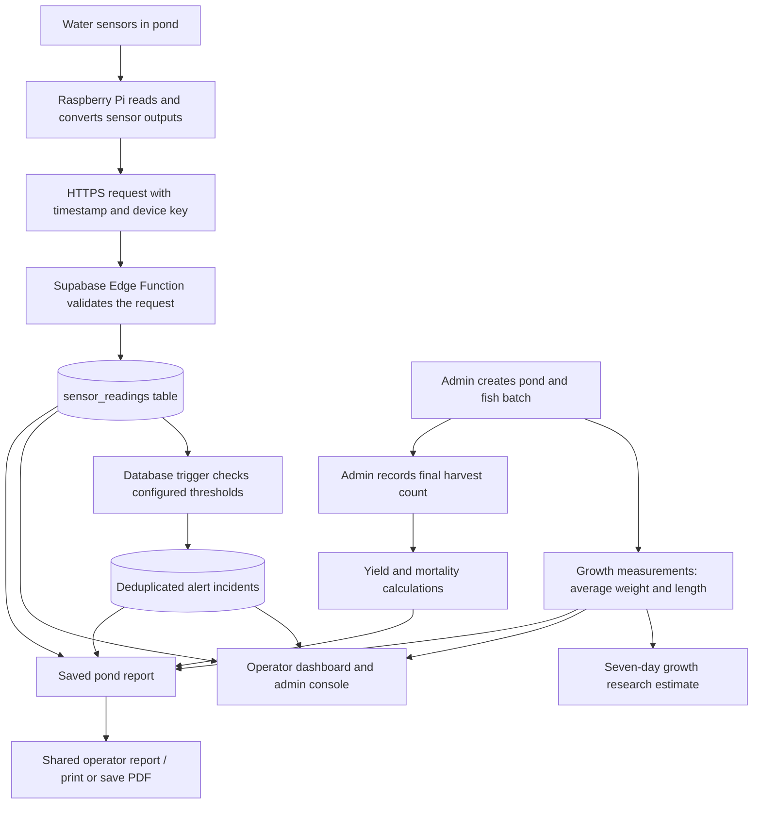

# IntelliPond System Overview

This guide describes how the application in this repository is intended to work, based on its routes, source code, and Supabase migrations. A deployed Vercel app or Supabase project can differ if its latest code, Edge Functions, environment variables, or migrations have not been deployed.

## What the system does

IntelliPond brings together water-quality readings, pond and fish-batch records, rule-based alerts, growth estimates, harvest-count calculations, and reports. Operators use the monitoring pages. Administrators configure ponds, batches, access, alert thresholds, and reports.

## System flow



## Water sensors and data path

The current physical setup includes sensors for:

| Measurement | Value stored by the app | Unit shown |
| --- | --- | --- |
| Dissolved oxygen | `do_mg_l` | mg/L |
| pH | `ph` | pH units |
| Water temperature | `temperature_c` | °C |
| Turbidity | `turbidity_ntu` | NTU |

The current setup measures dissolved oxygen with a dedicated DO sensor.

At a high level, the Raspberry Pi reads the sensor outputs, applies the relevant calibration and unit conversion, adds a timestamp, and sends the available values to the `ingest-sensor-reading` Supabase Edge Function. The function checks the device key, request format, timestamp, and numeric ranges, then writes the reading to `sensor_readings`. Its service-role credential is kept in the Edge Function environment; it is not sent to the browser.

**Hardware detail:** this overview does not specify the DO sensor model, wiring, ADC channel, or calibration constants. Use the current sensor configuration for those details.

The current ingestion function assigns submitted device readings to one configured BFAR pond ID. The admin console can manage multiple pond profiles, but this ingestion path is not yet a general device-to-pond mapping system; connecting additional ponds requires the function's pond assignment to be configured for each device or deployment.

### Alerts from readings

When a sensor reading is inserted, a database trigger checks each available measurement against the thresholds in **Admin → Settings**. Those thresholds are configurable by an administrator. Matching incidents are kept as alert records and deduplicated by pond and condition while active, rather than creating a new incident for every repeated out-of-range sample. Users can review, acknowledge, and follow incident status in the operator Alerts page and admin Alert History.

These are threshold-based rules. They are not produced by the growth model or a mortality ML model.

## Operator pages

- **Overview:** latest pond condition, sensor status, recent readings and trends, active alerts, and recommendations.
- **Growth:** selects a fish batch, shows recorded weight and length measurements, charts, and a seven-day growth estimate for an active batch. Operators can view harvest results when recorded.
- **Alerts:** reviews current and retained incidents, filters by date, severity, and status, and acknowledges active incidents when permitted.
- **Reports:** lists saved reports an administrator has shared with that operator. Operators cannot use this page to view reports for every pond by default.

## Administrator pages

- **Overview:** system-wide counts and recent activity.
- **Sensors:** searches and sorts sensor readings, filters by date, and can enter a reading manually.
- **Ponds:** creates and maintains pond profiles, including location and area.
- **Growth Records:** creates fish batches, enters stocking details and average growth measurements, and records harvest counts when a batch closes.
- **Alert History:** reviews, filters, and manages alert incidents.
- **Users:** manages account approval and roles, and can create operator accounts.
- **Reports:** exports readings or growth records, creates pond or batch report snapshots, and chooses which operators can see each report.
- **Settings:** edits water-quality warning thresholds and optional critical bands, and can enable or disable alert generation.

## Growth measurements and estimate

Administrators set up a batch with its pond, stocking date, and available stocking or starting measurements. Growth records contain the sampling date and measured average fish weight and/or length. The operator Growth page shows the actual samples separately from the model output.

The app loads the versioned artifact at `public/growth-model.json`. It uses cohort-weighted ordinary least-squares linear regression fitted to published milkfish measurements from FAO, WorldFish, and Taiwan Fisheries Research Institute sources. The weight and length equations are fitted separately. At prediction time, the input is the latest available measured weight or length for that batch; water-quality readings are not model inputs.

For each metric, the calculation is:

```text
predicted_daily_rate = intercept + slope * ln(latest_measurement)
forecast = latest_measurement * exp(predicted_daily_rate * 7)
```

The app presents this as a **Research estimate**. Its seven-day performance in independent Bangus pond batches has not been established, so the estimate is not a guaranteed growth outcome or a confidence percentage. Model sources, training details, and evaluation limits are in [`ml/README.md`](../ml/README.md) and [`ml/linear_regression_evaluation.md`](../ml/linear_regression_evaluation.md).

## Harvest yield and mortality

The current batch workflow follows the harvest-count process: when an administrator records the final harvest, they enter the harvest date and the number of fish counted. The system calculates:

```text
yield (fish) = harvested fish count
mortality count = stocked fish count - harvested fish count
mortality rate (%) = mortality count / stocked fish count * 100
```

Yield is the counted number of fish; the system does not infer harvest weight. If the original stocked count is missing, yield can still be shown but mortality cannot be calculated. The app does not currently show a daily mortality prediction or use an ML model for mortality. Older daily mortality records remain in the database for compatibility, but the active workflow is the final harvest count.

## Reports and research-reference values

An administrator creates a report for a pond, optionally limits it to a batch, selects a date range, and shares it with chosen operators. The database creates a saved snapshot containing the available sensor summaries, alert summaries, growth records, notes, and harvest results whose harvest dates fall in the selected period. The report can be viewed and printed or saved as a PDF. Later edits to source records do not silently rewrite an already saved snapshot.

Some historical BFAR batches have published contextual water-quality values available for display. The app labels these as **Research estimate** or **Research reference** and keeps them separate from actual sensor history. They are not rows in `sensor_readings`, are not evidence that a BFAR sensor recorded those values, and should not be described as such. In a report they may fill the contextual water-quality summary and coverage count when that historical batch has no sensor samples; the report labels that source.

## Accounts and data protection

Supabase Auth handles sign-in and sessions. The app reads the user's role and approval state from `user_roles` and `profiles` to protect operator and administrator routes. Database Row Level Security provides the corresponding access controls for stored records. Reports are shared through per-report recipient records, so an approved operator sees reports shared with them rather than every administrator report.

The browser uses the Supabase project URL and publishable key. Privileged credentials belong only in server-side Supabase secrets. Do not commit `.env` values, service-role keys, or the sensor device key.

## Deployment notes and limits

- Supabase schema changes are defined by the ordered files in `supabase/migrations/`. A local migration file does not apply itself to hosted Supabase.
- Edge Functions are deployed separately from the Vercel frontend. Pushing frontend code alone does not update `ingest-sensor-reading` or other hosted functions.
- The sensor ingestion function currently has one fixed pond assignment, as described above.
- Growth output is a seven-day research estimate; it is not a water-quality forecast, yield forecast, or mortality prediction.
- Yield and mortality are calculated from the final fish count and stocking count. They are not ML outputs.
- This guide documents the checked-in application and the team's stated current dedicated DO hardware. Confirm the actual hosted deployment and current Raspberry Pi sender separately before using it as a deployment or wiring record.
